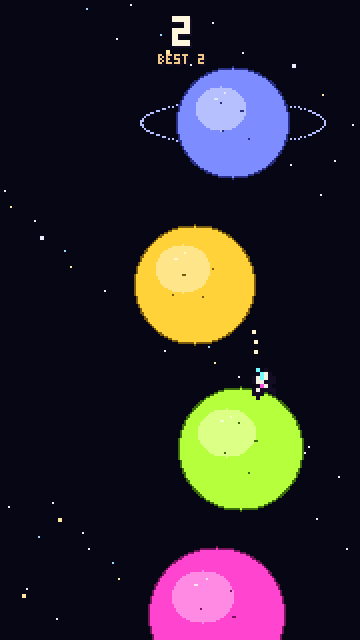

# Orbit Hop 🎮

A one-tap space hopper by StudioRApps. Ride a spinning neon planet, launch your astronaut, and stick the next landing.

[](https://gituserc1140.github.io/orbit-hop/)
[](docs/index.html)
[](docs/styles.css)
[](docs/game.js)
[](LICENSE)
[](https://github.com/sponsors/gituserc1140)

One tap launches the little astronaut off a rotating planet. Land on the next one to score and scroll up. Miss, drift off the screen, and the run is over. Planets get smaller, faster, and farther apart, and some of them slide.



# Play Now!

[](https://gituserc1140.github.io/orbit-hop/)

# Sponsor me!

[](https://github.com/sponsors/gituserc1140)

## How to Play

| Action | Mobile | Desktop |
|--------|--------|---------|
| Hop | Tap | Click / Space |
| Restart | Tap | Click / Space |
| Mute | Tap the speaker | Click the speaker |

- You start on a planet that is already spinning. The astronaut faces the way the hop will go: outward, with a push along the spin.
- **Tap to hop** when that aim lines up with the planet above. A landing scores **+1** and the view scrolls up.
- Miss, and you drift off the screen. Tap, click, or press space to play again.
- Later planets are smaller, spin faster, and sit farther apart. Every so often one slides side to side.
- **Best** is remembered on this device. The speaker in the corner mutes the blips.

## Project Structure

```
/docs
  index.html    – game shell
  styles.css    – full-screen dark pixel theme
  game.js       – loop, hop, planets, and scoring
  gameplay.png  – gameplay screenshot
index.html      – redirects to /docs/
```

## Running Locally

Open `docs/index.html` directly in any modern browser, or serve the `/docs` folder with a local HTTP server:

```bash
# Python 3
python3 -m http.server 8080 --directory docs
# Then open http://localhost:8080
```

The root `index.html` redirects to `./docs/`, so opening the repo root works too.

## Deploy to GitHub Pages

1. Push this repository to GitHub.
2. Go to **Settings → Pages**.
3. Set **Source** to `Deploy from a branch`, branch `main`, folder `/` (root).
4. Save – GitHub Pages will publish the game at `https://gituserc1140.github.io/orbit-hop/`.

The root `index.html` automatically redirects visitors to `./docs/`, so both the root URL and the `/docs/` URL open the game.

## Technical Notes

- Pure HTML5 Canvas pixel art – no external libraries or frameworks.
- Planets, the astronaut, and the HUD are drawn on an integer grid with smoothing off, so the pixels stay sharp.
- The starfield is three parallax layers. A landing squishes the planet and puffs a few pixels. A miss shakes the screen.
- Hop, land, and fail each play a short WebAudio blip. Mute is saved on this device.
- Tap, click, and space are one action: hop, or restart after a game over.
- Touch moves call `preventDefault` so the page does not scroll or zoom while you play.
- The canvas fills a portrait playfield, inset by the device safe areas, on phones and on desktop.
- The best score is kept in `localStorage` on this device.
